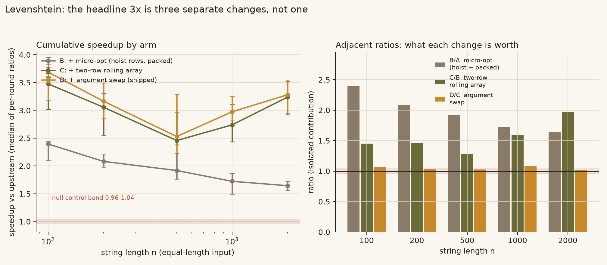
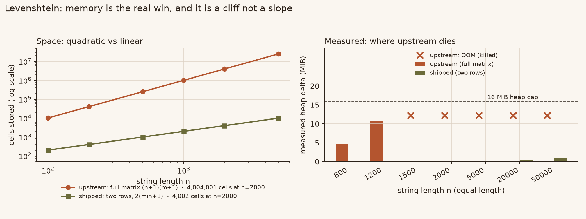
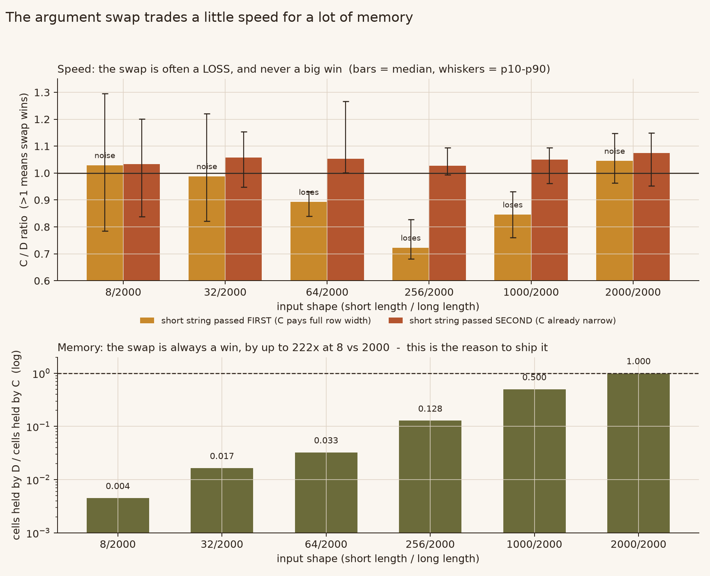

# levenshtein-opt-lab

Levenshtein 编辑距离的 **O(min(n,m)) 内存**版本，外加一套四臂基准，用来拆开「快了 3 倍」这个说法 —— 顺便说明一件反直觉的事：把参数换成「短的在内层」这个改动，**在速度上是亏的**。

上游实现（[trekhleb/javascript-algorithms](https://github.com/trekhleb/javascript-algorithms)）会分配完整的 `(n+1) x (m+1)` DP 矩阵。这里交付两行滚动版本，并且把每一臂都留在仓库里，让每个数字都能追溯到产生它的那一对相邻臂。

```js
import levenshteinDistance from './src/levenshteinDistance.js';

levenshteinDistance('kitten', 'sitting');   // 3
levenshteinDistance('', 'abc');             // 3
levenshteinDistance('😀', '');              // 2  （按 UTF-16 码元，与上游一致）
```

无依赖。Node 22+。

---

## 一句话结论

| 问题 | 答案 |
|---|---|
| 两行版本更快吗？ | 是 —— n=100..2000 上 **2.5x–3.3x** |
| 其中多少是「两行」的功劳？ | **只有 1.3x–2.0x**（C/B），其余是平凡微优化 |
| 省内存吗？ | 省 —— n=2000 时 **4,004,001 格 → 4,002 格** |
| 省内存有实际意义吗？ | 有 —— 16 MiB 堆下上游 **1500 字符就 OOM**，这版跑到 50000 |
| 交换参数能提速吗？ | **不能，而且经常慢 11–28%**。它是内存优化 |
| 会算错吗？ | 不会 —— 20,400 组差分零不一致 |



右边那张图是重点：`D/A = 3x` 实际是 `2.0x × 1.5x × 1.0x`。只报总数的话，你根本分不清哪个改动是真正承重的。

---

## 四臂，相邻比较

每一臂与邻居只差一个改动，所以下面每个比值都能指认「隔离它的是哪两个相邻臂」。

| 臂 | 做了什么 | 隔离出什么 |
|---|---|---|
| **A** `upstream` | 完整矩阵，`fill(null).map`，`j` 外 `i` 内 | 基线 |
| **B** `micro-opt` | A + 把 `m[j]`/`m[j-1]`/`b[j-1]` 提到局部变量，`fill(0)` 替掉 `fill(null).map` | 平凡改动 |
| **C** `two-row` | B + 两行滚动，内层跑 `b` | 算法改动 |
| **D** `shipped` | C + 内层改为跑**较短**的串 | 内存改动 |

Node 22.22.2，每 case 11 轮交错，取逐轮比值中位数，隔轮反转顺序。`n` 为等长输入。

| n | A | B | C | D | **D/A** | B/A | C/B | D/C |
|---|---:|---:|---:|---:|---:|---:|---:|---:|
| 100 | 0.106 ms | 0.045 ms | 0.032 ms | 0.030 ms | **3.69x** | 2.40x | 1.45x | 1.06x |
| 200 | 0.455 ms | 0.221 ms | 0.157 ms | 0.147 ms | **3.17x** | 2.08x | 1.47x | 1.04x |
| 500 | 2.868 ms | 1.453 ms | 1.108 ms | 1.087 ms | **2.53x** | 1.92x | 1.28x | 1.03x |
| 1000 | 13.09 ms | 7.753 ms | 4.754 ms | 4.376 ms | **2.97x** | 1.72x | 1.59x | 1.09x |
| 2000 | 65.82 ms | 39.80 ms | 20.69 ms | 20.24 ms | **3.28x** | 1.65x | 1.97x | 1.01x |

噪声底：同一轮里让 A 和它自己比，全 case 中位数落在 **0.96–1.04**。落在这个带里的都不算结果。

**看 C/B 那一列，别看 D/A。** 两行只值 1.3x–2.0x。总数里另一半来自「把三个数组下标提到局部变量」和「换一种分配方式」—— 这两个改动对完整矩阵同样有效，而且没人会为此写博客。

---

## 内存：这才是值得发布的理由



存储格数是确定性的，直接读代码：

| n | 完整矩阵 `(n+1)²` | 两行 `2(min+1)` | 倍数 |
|---|---:|---:|---:|
| 100 | 10,201 | 202 | 51x |
| 500 | 251,001 | 1,002 | 251x |
| 1000 | 1,002,001 | 2,002 | 501x |
| 2000 | 4,004,001 | 4,002 | 1,001x |
| 5000 | 25,010,001 | 10,002 | 2,501x |

`--max-old-space-size=16`（16 MiB 上限）下实测堆占用：

| 长度 | 上游 | 本版 |
|---|---|---|
| 800 | 4.76 MiB，过 | 过 |
| 1200 | 10.76 MiB，过 | 过 |
| **1500** | **OOM，exit 134** | 0.04 MiB |
| 2000 | OOM | 0.05 MiB |
| 5000 | OOM | 0.15 MiB |
| 20000 | OOM | 0.37 MiB |
| 50000 | OOM | 0.89 MiB |

断崖落在 1200–1500 字符之间。自己复现：

```bash
node --max-old-space-size=16 benchmarks/memory.mjs A 1500   # OOM, exit 134
node --max-old-space-size=16 benchmarks/memory.mjs D 1500   # 过
```

这不是「锦上添花」，是「2000 字符的输入能不能跑」的区别。

---

## 反直觉的地方：交换参数是要花时间的



C 和 D 对任何输入**算的格数完全相同**，因为 `(n+1)(m+1)` 是对称的。交换参数不可能减少工作量。它只改两件互相拉扯的事：

- **行宽。** C 的行宽跟着 `b.length`；D 跟着 `min(n,m)+1`。D 永远不会更宽，常常窄很多。
- **外层循环次数。** D 永远跑 `max(n,m)` 次。短串在前时，C 只跑 `min(n,m)` 次 —— 内层循环的**遍数**最多少 250 倍。

每形状 31 轮交错，判据事先定死（`p10 > 1.00` 判赢，`p90 < 1.00` 判输，其余算噪声）：

| 形状（短/长） | 短串在前 | 短串在后 |
|---|---|---|
| 8 / 2000 | 1.03 — 噪声 | 1.03 — 噪声 |
| 32 / 2000 | 0.99 — 噪声 | 1.06 — 噪声 |
| 64 / 2000 | **0.89 — 输** | 1.05 — 赢 |
| 256 / 2000 | **0.72 — 输** | 1.03 — 噪声 |
| 1000 / 2000 | **0.85 — 输** | 1.05 — 噪声 |
| 2000 / 2000 | 1.05 — 噪声 | 1.08 — 噪声 |

256 vs 2000 时交换参数**慢约 20%**，三个独立进程复现（0.807 / 0.793 / 0.823，区间不重叠）。原因就是算术：256 次外层 × 2001 格内层，变成 2000 次外层 × 257 格内层。格数一样，循环建立开销多 7.8 倍。

换来的是内存：那个形状下 **4,002 格 → 514 格**，8 vs 2000 时少 222 倍。

所以交换参数是一个**带一点速度代价的内存优化**。这个取舍站得住 —— 但它不是「把内层换成短的所以更快」通常被宣传成的那个样子，而且只测等长输入、或者只测一种参数顺序的基准永远看不到这一点。

---

## 这个仓库不声称什么

- **不声称是速度优化优先。** 只在乎速度、输入永远等长的话，`C`（不交换）一样快甚至更快。发布 `D` 是为了内存。
- **不给单一加速比。** 那个「3x」是三个改动；只有 1.3x–2.0x 是算法改动。
- **不声称时间复杂度变好。** 两者都是 O(n·m) 时间，只有空间从 O(n·m) 降到 O(min(n,m))。
- **没有跟 `fast-levenshtein` / `leven` 对比。** 它们用不同的取舍（提前退出阈值、TypedArray）。那是另一个问题。

---

## 行为差异

非字符串参数上，行为是**放宽**：

| 输入 | 上游 | 本版 |
|---|---|---|
| `null` / `undefined` | `TypeError` | `TypeError` |
| `123` 作第一个参数 | `RangeError` | 返回 `2` |
| `true` 作第一个参数 | `RangeError` | 返回 `2` |

原因：上游的 `Array(b.length + 1)` 拒绝非数字长度，而 `new Array(undefined + 1)` 退化成 `Array(NaN)`（长度 0），于是静默返回一个数。所有字符串输入行为完全一致。这是放宽不是破坏，但确实是行为变更，PR 描述里写明了。

UTF-16 码元的语义保留了：`'😀'` 仍然算 2，因为用 `[i-1]` 索引字符串拿到的是码元不是码点。改写没有去「修」这个。

---

## 自己验证

```bash
node --test tests/levenshtein.test.mjs   # 7 个测试：oracle 差分、对称性、
                                         # 不对称、emoji、不改参数、四臂互等
node benchmarks/run_all.mjs              # 完整基准，写 results.json
node benchmarks/run_all.mjs --quick      # 只冒烟，不写文件
node benchmarks/swap_probe.mjs           # 31 轮的交换参数专项
node benchmarks/memory.mjs --cells       # 存储格数表
node assets/make_figures.py              # 重生成三张图
```

测试对照的是**独立 oracle**（一份写法与两版都不同的完整矩阵实现），不是新版自己的对称性 —— 对一个开头就交换参数的实现来说，对称性断言是恒真的废话。

已做反向喂毒：注入 `return 0`、`+1`、差一、删掉 `currRow[0] = i`，测试全部失败。删掉 `src/levenshteinDistance.js` 会以「模块找不到」失败 —— 这一条专门用来抓这个领域最常见的翻车方式：验证脚本偷偷测的是自己内联的那份副本，而不是交付文件。

---

## 上游可用性

这份文件是按提交给 [trekhleb/javascript-algorithms](https://github.com/trekhleb/javascript-algorithms) 写的，该仓库用 airbnb 规则 lint，`npm run ci` = `npm run lint && npm run coverage`。

在**真仓库里**验过（不是自己拼的 eslint 配置）：

| 检查 | 结果 |
|---|---|
| 修改文件的 `eslint` | exit 0 |
| `eslint ./src/**`（全仓） | **exit 0，零输出** |
| `jest`（全仓） | **178 suites / 587 tests 全 passed** |
| 文件 sha1（跑前/跑后） | 一致（`050840612175…`） |

交换参数写成 `const long` / `const short` 而不是重赋值参数，因为 airbnb 的 `no-param-reassign` 会拦下重赋值写法 —— 这个细节在 CI 里发现就是两个 error 加一个被拒的 PR。

---

## 文件

```
src/levenshteinDistance.js        交付实现
src/levenshteinDistance.orig.js   上游原文件，逐字节一致（sha1 dd633691…）
benchmarks/arms.mjs               四臂，每臂只差一个改动
benchmarks/run_all.mjs            主基准 -> results.json
benchmarks/swap_probe.mjs         31 轮交换参数专项 -> swap-probe.json
benchmarks/confirm_256.mjs        256/2000 那个数字的三进程复核
benchmarks/memory.mjs             堆占用与 OOM 断崖
tests/levenshtein.test.mjs        node:test，7 个测试
assets/make_figures.py            从 JSON 重生成配图
docs/CLAIMS.md                    每条声称 + 产生它的命令
```

MIT。保留上游版权 (c) 2018 Oleksii Trekhleb —— 见 `LICENSE`。
